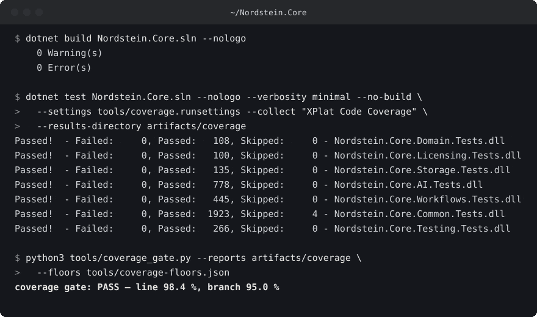

<div align="center">

<h1>Nordstein.Core</h1>

<p><b>The shared .NET foundation every Nordstein product is built on.</b><br>
Domain · Storage · Licensing · AI · Workflows<br>
Pre-release: all seven packages build, test and pack in CI. None is on a package feed yet.</p>

[](https://github.com/NordsteinSoftware/Nordstein.Core/actions/workflows/ci.yml)
[](https://github.com/NordsteinSoftware/Nordstein.Core/actions/workflows/codeql.yml)
[](https://dotnet.microsoft.com/download/dotnet/10.0)
[](LICENSE)

<a href="#quick-start">Quick start</a> · <a href="#packages">Packages</a> · <a href="docs/README.md">Docs</a> · <a href="#license">License</a>



</div>

## Quick start

Requires the [.NET 10 SDK](https://dotnet.microsoft.com/download/dotnet/10.0).

```bash
git clone https://github.com/NordsteinSoftware/Nordstein.Core.git
cd Nordstein.Core
```

```bash
dotnet build Nordstein.Core.sln   # warnings are errors
dotnet test  Nordstein.Core.sln   # the full suite, about 30 seconds
```

<details>
<summary>Use it in a product</summary>

Add this repository to your product as a git submodule, for example at `core/`, and name the packages you need:

```xml
<ItemGroup>
  <NordsteinCoreReference Include="Nordstein.Core.Common" />
</ItemGroup>
```

Your `Directory.Build.targets` turns each item into a `ProjectReference` (source mode) or a `PackageReference` at
`$(NordsteinCoreVersion)` (package mode). [`docs/architecture.md`](docs/architecture.md#how-consumers-reference-core)
explains both modes.

</details>

## Packages

| Package | Provides |
|---------|----------|
| [`Nordstein.Core.Common`](Nordstein.Core.Common) | Clock and randomness seams, async locks, validation, cryptography, credential primitives, durable file IO, text, settings, events, hosting defaults |
| [`Nordstein.Core.Domain`](Nordstein.Core.Domain) | Entity and object contracts, factory delegates, test-data generators, repository, transaction, archive and paging contracts |
| [`Nordstein.Core.Storage`](Nordstein.Core.Storage) | EF Core base context, generic repositories with optimistic concurrency, ambient transactions, a reference-data cache. You bring the database provider |
| [`Nordstein.Core.Licensing`](Nordstein.Core.Licensing) | License JWT verification, runtime activation, feature and limit queries, a periodic server check with offline grace |
| [`Nordstein.Core.AI`](Nordstein.Core.AI) | Messages, tools, prompts, completions, the agent and model-client contracts, the tool-call loop, structured output parsing |
| [`Nordstein.Core.Workflows`](Nordstein.Core.Workflows) | A directed acyclic graph of typed nodes, a validator, a deterministic interpreter with a step journal, suspend and resume |
| [`Nordstein.Core.Testing`](Nordstein.Core.Testing) | `BaseTest<TModule>` with one Autofac container per test, shared fakes for clock, HTTP, logging and certificates, architecture fences, perf budgets |

Dependencies point one way: a product depends on Core, and Core knows no product.
[`docs/architecture.md`](docs/architecture.md) has the layering.

## Develop

```bash
dotnet build Nordstein.Core.sln
dotnet test Nordstein.Core.sln --settings tools/coverage.runsettings \
  --collect "XPlat Code Coverage" --results-directory artifacts/coverage
python3 tools/coverage_gate.py --reports artifacts/coverage \
  --floors tools/coverage-floors.json
```

CI fails a package below 90 % line or 90 % branch coverage. The rules for a change:
[`CLAUDE.md`](CLAUDE.md) · [`docs/`](docs/README.md) · [`PUBLISHING.md`](PUBLISHING.md)

## License

[Elastic License 2.0](LICENSE). Provisional: we settle the terms for Core as a separately distributed library before
the first package publish ([`PUBLISHING.md`](PUBLISHING.md#2-the-licence)).

<div align="center">
<br>
<sub>Built by <a href="https://nordstein.eu">Nordstein Software GmbH</a> in Absam, Austria</sub>
</div>
